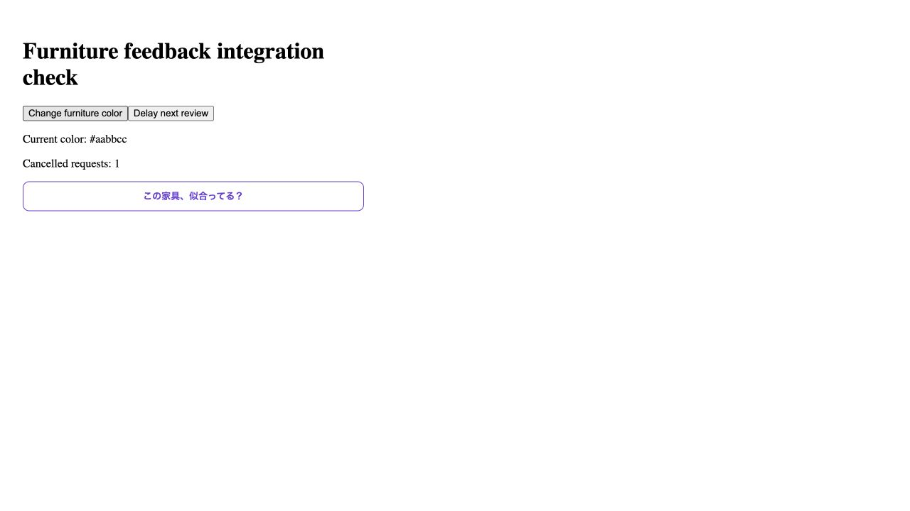

# Furniture feedback integration verification

2026-10-12, PR #134 integrated with main including #139 and #140.

The actual FurnitureReviewPanel rendered a controlled repository response. Changing the selected furniture color removed the previous verdict. Changing color during a delayed request aborted that request once and restored the ask button. This is local component evidence with a fixture repository, not live Gemini evidence.

Frontend lint/build passed. The full existing Rails suite passed: 75 examples, zero failures. Swagger generation passed: 64 request examples; regenerated Swagger and web types had no drift. RuboCop passed for the repaired downloader. Twenty-eight isolated downloader checks covered nonpublic and mixed DNS results, pinned connections, image formats, byte bounds, redirects and deadlines. No permanent tests were added.
