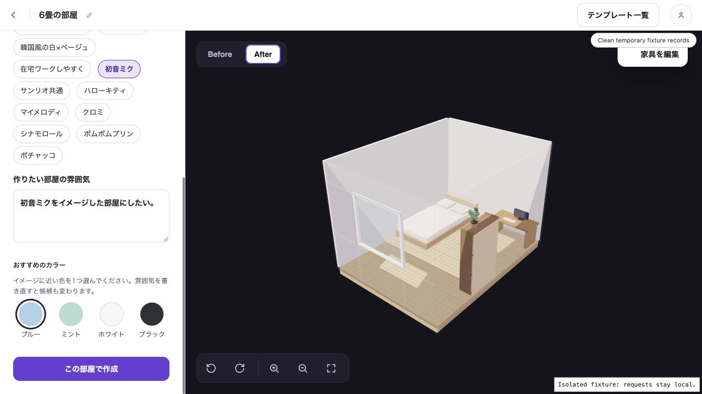
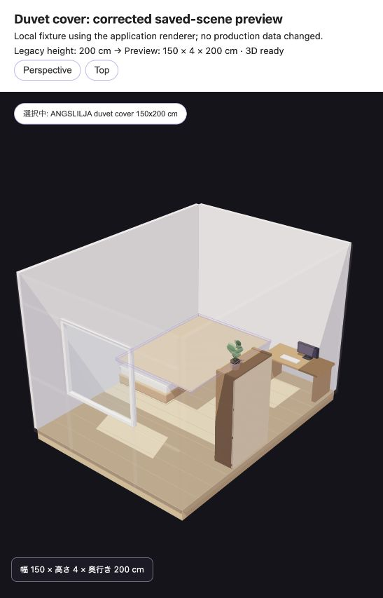

# Miku room quality

The theme now suggests ordinary cyan/blue furniture with neutral supporting furniture and Miku goods as accents. The former character section is replaced by optional theme-name chips. A name-only Miku brief suggests Blue, Mint, White and Black; explicit user colors remain authoritative. The duvet preview uses estimated cloth thickness instead of a product length as height.

These screenshots use the application components with local fixtures. Before integrating newer main commits, frontend lint/build, ten-file RuboCop, 17 existing request examples, and 21 one-off builder checks passed. The builder checks include seeded catalog data and controlled provider responses; they do not establish live Gemini quality. Production generation was separately exercised before this release, returning 16 items for ¥70,884, but with mostly white/neutral furniture.

The local seed catalog differs from production: the seed has 92 details, while the signed-in production admin showed 336. Catalog availability and current shop prices remain constraints. No permanent tests, API enums, DB schema or environment variables were added. Google Docs is unset; the local specs record the user's decisions.
